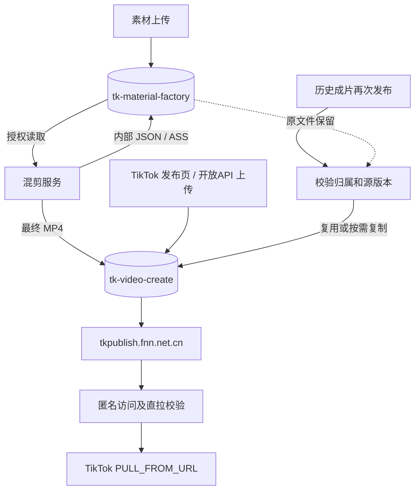

# 素材与 TikTok 发布双桶

素材库继续使用 `tk.generation.upload.oss`，原文件和素材关联不迁移。生成的最终 MP4、发布图片、TikTok 后台和开放 API 的发布上传使用独立的 `tk.generation.upload.publish-oss`。内部生成计划、字幕和诊断 JSON/ASS 仍使用素材存储及授权读取。

```yaml
tk:
  generation:
    upload:
      storage-type: oss
      oss:
        enabled: true
        bucket: tk-material-factory
        endpoint: oss-cn-beijing.aliyuncs.com
        region: cn-beijing
        public-base-url: https://tk-material-factory.oss-cn-beijing.aliyuncs.com
        access-key-id: ${TK_MATERIAL_OSS_ACCESS_KEY_ID}
        access-key-secret: ${TK_MATERIAL_OSS_ACCESS_KEY_SECRET}
        upload-path-prefix: tk
      publish-oss:
        enabled: true
        bucket: tk-video-create
        endpoint: oss-cn-beijing.aliyuncs.com
        region: cn-beijing
        public-base-url: https://tkpublish.fnn.net.cn
        access-key-id: ${TK_PUBLISH_OSS_ACCESS_KEY_ID}
        access-key-secret: ${TK_PUBLISH_OSS_ACCESS_KEY_SECRET}
        upload-path-prefix: tk
        read-url-expire-seconds: 0
```

`publish-oss.enabled` 默认 false，保留旧部署行为；启用后配置不完整应失败，不能退回素材桶。发布域名需在当前 TikTok 应用验证，并保持 HTTPS、无跳转和下载全程可访问。素材桶启用阻止公共访问，通过凭据读取。发布桶禁止公共写，上传使用服务端授权。

当前生产桶还被历史 OpenAPI 文件和其它项目使用。上线先将发布桶从 public-read-write 收敛为 public-read，保留既有匿名读取，素材桶改 private 且保留公共访问阻止。未经其它使用方核验，不能直接关闭历史目录读取。后续收紧为 private + 目录级匿名 Get 属于单独权限调整。



历史私有来源在异步发布执行阶段复制，映射记录用于复用同一版本副本；素材原文件不动。已有发布 ID 的任务继续原状态同步，不重新初始化。文件复制使用条件请求检查源版本，大文件采用分片复制，失败中止未完成分片。后台所属租户/公司、开放 API 客户端及持久化来源校验仍须通过。

发布副本、上传会话和历史文件的签名、完成校验与清理按实际文件位置选择桶，禁止直接替换历史 URL 域名。保留现有生命周期规则和等待/下载中的文件保护；副本来源校验失败或目标被清理后，需要重新准备发布文件。

部署顺序：备份生产配置和表结构、应用增量 SQL、核对桶权限、准备新 release、验证变更 allowlist 后切换。生产包含本分支以外的已部署补丁，不能用干净分支整 JAR 覆盖；必须保留其它 JAR entry，或在完整同步后的生产源码基线构建。

增量脚本位于产品根 `yudao-module-tk/src/main/resources/sql/tk_dual_bucket_publish_upgrade_mysql.sql`，仅增加可空的上传会话目标 URL 字段及发布副本映射表，可重复执行，不更新历史素材或发布任务 URL。

回滚时切回原 release 和配置，增量表/可空字段保留以兼容旧版本；不回滚业务任务状态、不删除素材。权限收敛不随应用回滚恢复公共写入。

验收应覆盖素材桶授权读取、发布桶新 MP4/JPEG 匿名 GET/Range、跨桶复制、生成最终输出与内部附件分流、上传会话和清理、发布初始化幂等。存储验收不等于真实 TikTok 发帖成功，实际发布需使用授权账号另行验证。
