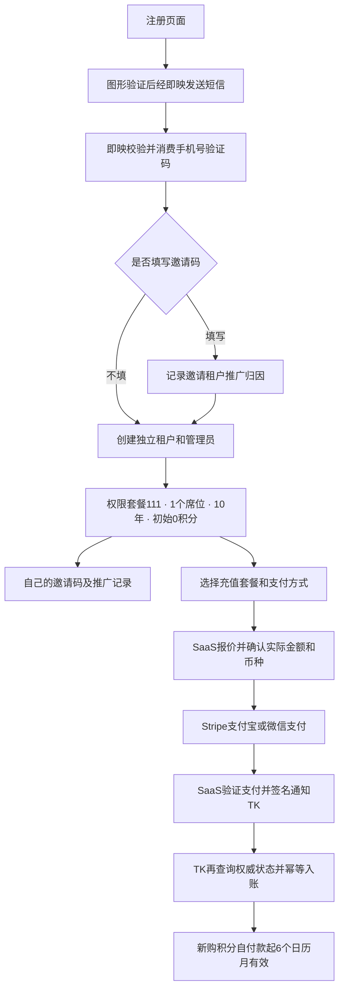

# 注册、支付、租户邀请码部署记录 — 2026-11-14

三项目已提交、推送并部署；TK 注册和四档套餐支付宝/微信支付已开启。用户已授权同步最新代码、开发、提交、推送及部署，确认推广归因、套餐111、1个成员席位和10个日历年账号有效期。

## 发布版本与入口

| 项目 | 已部署运行代码 | 分支 | 入口 |
| --- | --- | --- | --- |
| TK | 04ee927966155e348dd5cfa1f1663f9d513bcbb8 | codex/registration-payments-referral | https://clipforgestudio.fnn.net.cn |
| 即映短信桥接 | e79fae61fc36cdc4a7639df5ab049babd0a13755 | codex/tk-phone-verification | https://xiumeiai.fnn.net.cn |
| Saas发布支付 | f87ba6d0a04ae3febdd303410b1d44f12dd3857c | codex/clipforge-payments | https://tokdeploy.com |

SaaS 后续9203978仅增加真实TK回调响应测试和fixture，运行代码与f87ba6d0相同；后续文档提交同样不改变已部署程序。TK合入已部署dbcdbf52双桶/图片发布分支，并保留自动化API补丁d73996b9（对应b51fda30）；SaaS合入最新生产工作台23b63ef。TK原有system/TK类均保留，工具/模型/工作器依赖检查通过。

TK发布目录：`/data/Tk/releases/release-registration-payment-20261114`，`/data/Tk/current`已指向它。JAR SHA256：`8267e3c1e44b71d9063f895aa02156ed7753057af42ebde0cb21df598cb83663`。

即映采用仅新增6个条目的JAR增量，原条目逐一校验未改，现用JAR SHA256：`bd4027a944dcc1834a1b99172f39c79e980e222051b97ecacb97d81342d073ad`。

SaaS镜像：`xiumei-publish:clipforge-f87ba6d0`；发布与当前有效Compose文件：`/opt/xiumei/publish/releases/clipforge-20261114-f87ba6d0/compose.candidate.private.json`。该文件保留完整原有配置；后续部署应从当前运行容器标签确定有效Compose，避免沿用较早photo-grid配置覆盖新功能。配置文件含服务端密钥，仅服务器root可读，不应提交。

## 用户流程

邀请码可选；填写后仍注册独立租户，记录推广来源，不加入邀请方团队，不产生返佣。现存有效业务租户的邀请码已回填，缺失数0。历史积分保持非追溯到期兼容。

| 套餐 | 人民币金额 | 积分 |
| --- | ---: | ---: |
| P1000 | 1000元 | 250 |
| P5000 | 5000元 | 1333 |
| P10000 | 10000元 | 3077 |
| P50000 | 50000元 | 16667 |

## 数据库与配置

TK已备份数据库（688636372字节）后执行三份迁移：`tk_registration_invite_upgrade_mysql.sql`、`tk_online_payment_upgrade_mysql.sql`、`tk_registration_payment_menu_mysql.sql`。执行前冻结余额与进行中日志校验无差异；菜单6090–6092安装，套餐111包含新菜单，旧匿名注册关闭。此前使用生产同结构临时库连续两次演练通过；临时库已删除。

SaaS已备份数据库后一次执行`20261114000000_clipforge_payments.sql`，SHA256：`d9d4f90cecb2b37d12a12cc86a65e811ce2b75437159da8435e719edf634ecfd`。三张独立表启用RLS，anon/authenticated无读写和TRUNCATE权限，service_role RPC权限通过。已应用迁移今后不得编辑重放；结构更新应新增迁移。

即映、TK与SaaS专用签名密钥匹配；Stripe独立webhook已创建并启用，保留原产品webhook。TK的受限配置位于`/data/Tk/shared/registration-payment-20261114/tk.env`，systemd新增独立EnvironmentFile；生产进程验证套餐111、1席位、10年及正式支付模式正确。SaaS新增CLIPFORGE配置也已保存到受限app.env，历史订单恢复工作器开启。

本次发现支付服务器供应商DNS将TK域名解析到不可达的124.238.244.202；101.206.204.178/179的HTTPS与证书校验通过。当前仅SaaS web/worker通过Compose extra_hosts将`clipforgestudio.fnn.net.cn`指向101.206.204.178，保留原Host/SNI、证书和HMAC校验；未更改全局DNS或即映域名映射。工作器内真实HTTPS请求已验证成功。该CDN节点若调整，应先验证新节点的TLS及回调连通，再更新同一容器级覆盖；此项配置必须随后续Compose部署保留。

## 验证结果与边界

- TK最终22类152项定向回归全部通过，包含注册事务/唯一性、权限、真实MyBatis/JDBC账务、支付状态、实际序列化通知响应、原自动化和发布相关回归。此前真实MySQL8可重复读并发8/8通过。
- 支付通知回归用MockMvc生成的真实TK响应驱动SaaS工作器，旧code0能复现失败，修复后code200成功确认；26项支付状态/SQL测试通过。此前全通道49项、44个pgTAP断言及3项类型检查通过。
- 即映101项回归和打包通过；公网无签名拒绝，合法签名的无效手机号进入校验，未调用短信发送。
- 前端类型检查、生产构建、品牌检查通过；选定45项测试44通过，另1项是本次未修改的发布页formatDate import历史断言失败，已在开发前和整合后复现，未扩大修改。
- 线上注册配置、前端文件哈希、两项产品服务、支付web/worker与数据库健康通过；受保护接口无登录返回401；非法支付通知拒绝；产品服务器签名访问SaaS未知订单404，重复nonce拒绝；四档金额/积分及两种支付渠道一致。
- 真实短信接收、真实充值、真实退款及真实资金到账全链路未执行。本次没有指定实际接收号码或测试购买用户，不将模拟/负例验证描述为真实资金验收。

## 运维恢复

TK发布目录保留迁移校验和、激活/验收记录与数据库/原配置备份；SaaS发布目录保留pg_dump、迁移校验和、实际旧镜像Compose及激活/开启记录。即映保留previous.jar和原配置备份。测试MySQL库/账号、隧道和候选预览容器已清理。

需要暂停新购买时先关闭SaaS CLIPFORGE_PAYMENTS_ENABLED，保留当前兼容代码、webhook、worker和账务数据以完成在途支付/退款/通知。TK关闭新购买时也保留恢复工作器。只有确认没有任何在途或历史新通道订单时，才可考虑退回不包含新通道的旧代码；不能在已有付款后直接恢复旧数据库或删除支付/积分表。
