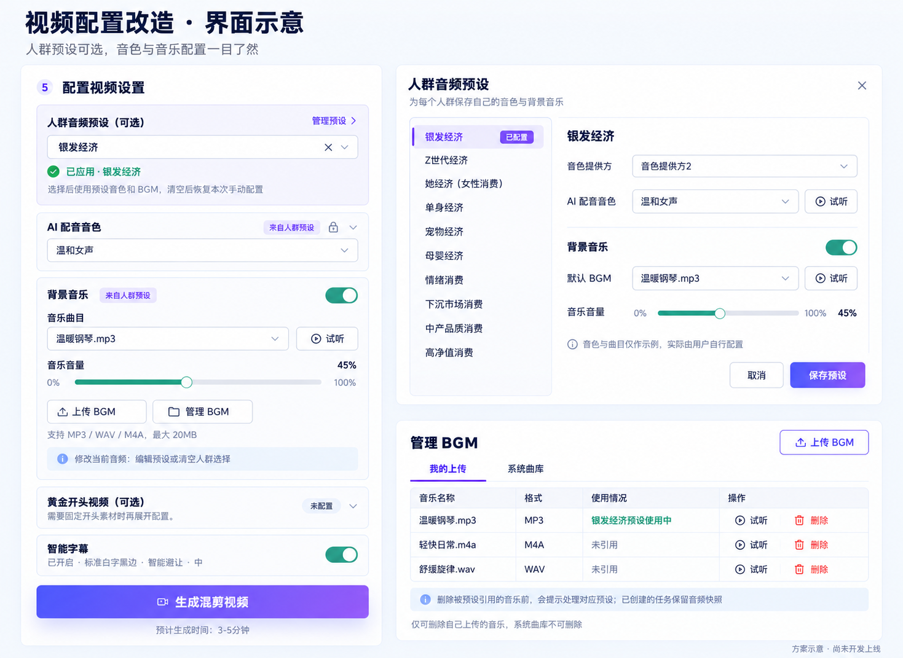

# BGM 管理、人群音频预设与混音音量改造方案

日期：2026-10-30。状态：用户已确认开发、合并 main、推送并同步服务器。本文件保留批准方案，以下问题定位描述的是改造前的代码基线；实际发布版本以服务器发布清单为准。

图中音色、曲目、45% 音量均为界面演示数据，不代表系统已配置或推荐这些人群必须使用这些声音。

# 一、需求理解

## 我的目标

1. 用户可以上传 BGM，并管理、试听、删除自己上传的 BGM。
2. 增加可选的人群音频预设，用户分别保存各人群的音色、BGM 及音乐音量；选择后按预设生成，不选择则使用本次正常流程中的手动配置。
3. 解决音乐音量拖到最大，成片中的 BGM 仍然偏小的问题。

## 实际需要解决的问题

当前本地源码已经有 BGM 上传、列表、删除接口及前端 API 封装，页面也有上传按钮；欠缺的主要是删除和管理入口，以及删除后的引用处理。无须重复搭建一套音乐上传系统。

音量问题有明确的代码依据：

| 位置 | 当前行为 | 影响 |
| --- | --- | --- |
| dashboard/index.vue:999 | 滑块范围 0.01–0.30 | 拖到最右实际只设置到 30% |
| dashboard/index.vue:5192、5771 | BGM 单曲试听同样封顶 0.30 | 试听也存在相同限制 |
| TkGenerationTaskServiceImpl.java:648 | 创建任务时再次限制到 0.01–0.30 | 仅修改前端无法解决 |
| DefaultTkVideoRenderService.java:429 | 渲染时再次限制到 0.01–0.30 | 仅修改任务服务仍然无法解决 |
| DefaultTkVideoRenderService.java:413、353 | 两路、原声开头的多路混音没有显式设置 amix normalize | 默认会缩放参与混音的输入，带来额外衰减 |
| DefaultTkVideoRenderService.java:40、416 | 配音有 loudnorm，BGM 直接乘 volume | 曲目自身响度不同，成片中的音乐听感不一致 |

FFmpeg 的 amix 默认启用 normalize，默认每路权重为 1。在常规两路都参与的片段里，可以将音乐的线性系数理解为约 0.30 × 1/2 = 0.15。这里说的是振幅系数，不是人耳感知音量的百分比；配音也会被混音器缩放，两者相对比例没有因此改变。

依据：[FFmpeg 官方 amix 文档](https://www.ffmpeg.org/ffmpeg-filters.html#amix)。以上为本地代码与官方过滤器行为核对，尚未对线上具体任务及其原始 BGM 做测量，因此不能排除某首原始音乐本身偏小等额外因素。

# 二、需要增加的内容

## 产品功能

1. 增加“管理 BGM”弹窗，包含“我的上传”“系统曲库”、试听、上传、删除、引用状态。
2. 用户仅能删除自己上传且在当前租户/公司范围内的音乐；系统音乐不可由普通用户删除。沿用现有数据范围规则，并补充写操作的创建者校验。
3. 增加“人群音频预设（可选）”单选项，初始不选，不根据账号或内容自动套用。
4. 支持以下 10 个固定分类：银发经济、Z世代经济、她经济（女性消费）、单身经济、宠物经济、母婴经济、情绪消费、下沉市场消费、中产品质消费、高净值消费。
5. 每个用户在当前租户/公司范围内独立保存上述分类的配置。配置内容包含音色提供方、已有音色选择字段、BGM 开关、曲目、音乐音量。BGM 关闭是有效配置。
6. 选中已配置的人群后，生成使用该预设。对应音频控件显示“来自人群预设”并禁止直接改值，可通过“编辑预设”修改；清空人群选择后，恢复选择前的本次手动配置。
7. 未配置的人群显示“待配置”，点击后进入配置；保存成功后才启用，取消时保留原先有效设置。音色或 BGM 失效时明确提示重新配置，不自动换成第一首音乐或其他音色。
8. 人群预设只替换音色选择，不擅自开启流程中明确关闭的配音；是否配音继续受现有流程规则约束。
9. 仅将人群分类用于本次音频设置，不扩展为文案改写、素材筛选、推荐算法或付费套餐。

## 前端

1. 页面：复用 dashboard 第 5 步，在音色设置之前增加人群预设入口，不增加独立主页面。
2. 组件：新增人群配置弹窗、BGM 管理弹窗，复用现有音色选项与试听能力。
3. 交互：未选/已应用/待配置/已失效状态、清空恢复、上传成功后选中、删除确认、被预设引用时的处理提示。
4. 音量：新版本调整为 0–100%，0% 真正静音；BGM 开关仍独立存在。界面提示较高音量可能盖过配音。
5. 提交：在提交与批量展开前固定本次有效配置；已有手动配置与正在应用的预设分别保存，避免互相覆盖。
6. 单曲试听同步开放 0–100%。单曲试听与成片混音含义不同，本期不宣称两者听感完全一致。

## 后端

1. 接口：复用 /tk/bgm/list、/upload、/delete；列表补充 canDelete 与引用信息，新增 BGM 引用查询；删除可增加可选的确认解除引用参数，保留原有 URL 与请求方式。
2. 接口：新增 /tk/audio-audience-preset/list、/get、/save、/reset，限定当前用户及租户/公司范围。
3. 服务：新增人群预设保存和有效音频配置解析，复用现有音色服务、BGM 校验服务和任务生成链路。
4. 任务：普通生成、带开头上传、批量生成均在创建前解析一次有效配置并保存快照；重试使用任务中已有快照。
5. 混音：集中音量范围与混音版本规则，覆盖配音+BGM、纯 BGM、原声开头+正文、关闭 BGM 等分支。
6. 删除：沿用现有停用方式，不立即删除文件；被人群预设引用时，先告知影响范围，用户确认后同事务停用素材并将相关预设标记为待重新配置。

## 数据库

1. 复用 tk_bgm_asset。上传、列表、逻辑停用已有，无须再建 BGM 表；creator 已存在，可用于删除授权校验。
2. 新增 tk_audio_audience_preset：id、tenant_id、company_id、user_id、audience_code、tts_provider、voice_config、bgm_enabled、bgm_asset_id、bgm_volume、version、config_status 及审计字段。voice_config 仅保存现有提供方所需的选择字段，不存密钥或原始音频。
3. 唯一索引：(tenant_id, company_id, user_id, audience_code)。该新表 company_id 必须非空，无公司范围规范化为 0，避免 MySQL NULL 导致重复预设；不修改旧表 company_id 语义。
4. 引用索引：(bgm_asset_id, config_status)，用于删除引用查询。
5. tk_generation_task 增加 audience_code、audio_preset_id、audio_preset_version、audio_mix_version；实际音色、bgm_url、bgm_volume 等继续使用现有任务字段作为执行快照。
6. 现有 bgm_volume decimal(4,3) 可以保存 0.000–1.000，不必仅为开放 100% 扩容。
7. 历史任务默认 LEGACY_V1，新增客户端显式请求 V2；不得把历史 0.30 自动改写为 1.00。

## 第三方服务

1. API：复用现有音色提供方、文件存储、FFmpeg，无须新增外部付费服务。
2. 配置：扩展 FFmpeg 音频过滤链与混音版本配置，开发时确认现有运行版本支持相关选项。
3. 权限：上传、删除、预设保存继续受登录、现有生成权限和数据范围约束；对素材和音色引用重新做服务端权限校验。

# 三、实现方案

## 方案选择

| 方案 | 优点 | 代价 | 建议 |
| --- | --- | --- | --- |
| 在现有生成链路前增加可选预设，复用上传与渲染 | 改动集中，保留现有流程，可服务端校验 | 需增加轻量预设表与配置解析 | 推荐 |
| 仅浏览器保存预设并回填表单 | 初期开发量较少 | 换设备丢失，难以统一权限、版本和批量快照 | 不采用 |
| 新建音频推荐/管理中心 | 可做复杂推荐与多人协作 | 本次范围大幅增加 | 本次不采用 |

## 第一步：补齐现有 BGM 管理

接通已有上传和删除 API；增加“管理 BGM”弹窗及权限、引用提示。删除当前选中的音乐时停止试听，清空选择并提示重选，禁止静默换歌；不立即删除底层文件，确保已经创建的任务仍可读取已保存的音频 URL。

## 第二步：增加可选人群预设

增加固定分类枚举与用户配置表。前端使用“手动草稿 + 当前预设”两份状态，服务端统一决定本次生效配置。预设未填写完整或所引用音色不支持当前目标语言时阻止应用并给出明确修改入口。

## 第三步：修复音乐音量并覆盖各渲染分支

V2 将音量范围统一为 0–1，并支持 0；对 BGM 做基础响度标准化后再应用用户音量；显式控制 amix 的缩放行为；混音后增加峰值限制，避免只取消 normalize 导致过载。原声开头保留现有起止与正文延迟语义。BGM 开关关闭、0% 音乐、配音关闭、短视频淡入淡出均需验证。

输入标准化在用户音量之前，避免在音量之后对纯 BGM 再强制拉回固定响度，从而抵消用户调节。首期可在现有渲染过程内完成，不新增调度系统；重复曲目的标准化缓存列为后续优化。

## 第四步：冻结快照并做兼容验收

预设配置用 version 做并发修改检测；提交携带预设编号和版本，后端若发现已经修改则提示刷新确认。批量任务必须在展开前固定同一份配置，不能逐个重新读可变预设。已创建任务与重试继续使用各自快照和混音版本。

## 文件定位

产品源根目录：ruoyi-vue-pro-master/ruoyi-vue-pro-master/ruoyi-vue-pro-master/。

前端路径以下均位于 yudao-ui/yudao-ui-admin-vue3/，后端位于 yudao-module-tk/。

修改现有文件：

- 前端 src/views/tk/dashboard/index.vue：接入人群选择、状态来源、手动恢复、音量范围和提交快照。
- 前端 src/api/tk/bgm/index.ts：补充删除授权、引用查询与确认参数。
- 前端 src/api/tk/generation/index.ts：扩展可选预设和混音版本字段。
- 后端 src/main/java/cn/iocoder/yudao/module/tk/controller/admin/bgm/TkBgmAssetController.java 及 vo/TkBgmAssetRespVO.java：复用接口并返回管理信息。
- 后端 service/bgm/TkBgmAssetService.java、TkBgmAssetServiceImpl.java：删除授权、引用处理及事务。
- 后端 controller/admin/generation/vo/TkGenerationTaskCreateReqVO.java、TkGenerationTaskRespVO.java：新增可选字段并兼容旧客户端。
- 后端 service/generation/TkGenerationTaskServiceImpl.java：预设解析、批量共用快照、V1/V2 音量规则。
- 后端 dal/dataobject/TkGenerationTaskDO.java：保存本次预设来源与混音版本。
- 后端 service/generation/pipeline/DefaultTkVideoRenderService.java：分版本混音和峰值保护。
- 相关现有 BGM、生成服务、渲染测试文件：补充边界和回归测试。

新增文件：

- 前端 src/views/tk/dashboard/components/AudioAudiencePresetDialog.vue。
- 前端 src/views/tk/dashboard/components/BgmManagerDialog.vue。
- 前端 src/views/tk/dashboard/audioSettings.mjs：有效设置和手动草稿恢复等纯逻辑。
- 前端 src/api/tk/audio-audience-preset/index.ts。
- 后端 controller/admin/audiopreset/TkAudioAudiencePresetController.java 及配套 VO。
- 后端 service/audiopreset/TkAudioAudiencePresetService.java、TkAudioAudiencePresetServiceImpl.java。
- 后端 dal/dataobject/TkAudioAudiencePresetDO.java、dal/mysql/TkAudioAudiencePresetMapper.java。
- 后端 enums/TkAudioAudienceEnum.java。
- 后端 service/generation/pipeline/TkAudioMixSupport.java：统一新旧版本音量与过滤链规则。
- 后端 src/main/resources/sql/tk_audio_audience_preset_upgrade_mysql.sql：增量建表及任务字段升级。
- 配套权限、预设解析、前端状态与音频实际渲染测试。

删除文件：无。优先沿用现有架构、音色服务、BGM 服务与 FFmpeg 执行方式，不调整项目目录。

# 四、技术方案

## 架构

现有 dashboard → 可选的人群预设解析 → 现有任务服务保存执行快照 → 现有生成流水线 → 分版本 FFmpeg 混音。

## 数据流

未选人群 → 本次手动音色、BGM 和音量 → 权限与有效性校验 → 快照 → 生成。

已选人群 → 当前用户已保存预设 → 服务端校验编号、版本、音色和曲目 → 实际音频配置写入任务 → 生成。

清空人群 → 恢复本次选择前的手动草稿 → 正常流程；不自动恢复成系统默认音乐。

## 调用流程

1. 打开页面，读取现有音色、BGM 与用户预设摘要。
2. 配置或选择人群，前端展示最终将使用的声音和音乐；没有配置则先保存。
3. 提交时固定前端快照，服务端在已解析的租户/公司上下文内校验预设及引用。
4. 所有任务创建入口先解析生效音频，批量入口仅解析一次，再复制到子任务。
5. 执行器从任务快照取值，V1 继续原逻辑，V2 使用新范围和混音链；不在执行时回读可变预设。
6. 删除素材和保存预设围绕同一素材做事务与并发校验，防止“刚保存就失效”的竞态；用户确认解除引用后使对应预设进入待配置状态。

# 五、开发任务拆解

| 任务 | 目标 | 文件 | 实现与验收 |
| --- | --- | --- | --- |
| Task 1 | 补齐 BGM 管理 | BgmManagerDialog.vue、bgm/index.ts、现有 BGM Controller/Service/VO | 上传后可选择；仅本人可删除；系统音乐不可删；跨租户拒绝；引用删除有确认；当前选择删除后提示重选 |
| Task 2 | 人群配置持久化 | 新增枚举、DO、Mapper、Controller/Service/VO、增量 SQL | 10 个固定分类；按用户及租户/公司隔离；保存完整音色字段；版本冲突与失效引用有明确错误 |
| Task 3 | 可选预设界面 | dashboard/index.vue、AudioAudiencePresetDialog.vue、audioSettings.mjs、预设 API | 默认不选；选中采用预设；清空恢复原手动配置；不改变其他生成参数 |
| Task 4 | 生成快照及兼容 | Generation VO/DO/Service、前端 generation API | 旧请求继续可用；单次与批量配置一致；预设后续修改不影响已建任务；重试使用原快照 |
| Task 5 | 修复混音音量 | DefaultTkVideoRenderService.java、TkAudioMixSupport.java、相关测试 | 前端、任务、渲染、试听范围一致；V2 0/10/30/60/100% 有可测差别；音量增大音乐能量不反向下降；0% 无音乐；峰值受控；配音清晰；原声开头无错位 |

验证采用针对性的前端状态测试、后端服务测试和实际 FFmpeg 输出测量。音频样本覆盖较安静/正常响度的 BGM、无配音、原声开头、短视频、单声道/双声道；测量响度、峰值和输出时长，并人工听验。纯配置/命令字符串断言不能替代成片音频验证。

# 六、风险分析

| 检查项 | 风险 | 处理 |
| --- | --- | --- |
| 性能 | BGM 标准化增加 CPU 消耗；引用查询逐行执行会产生 N+1 | 使用原渲染过程；引用数量批量查询；后续缓存重复音乐的处理结果 |
| 安全 | 删除当前可读的公司素材可能越权；伪造音色/BGM 引用 | 删除增加 creator 与现有范围双重校验；后端重新验证全部引用；上传验证可解码音频和大小，不能只看扩展名 |
| 数据 | 删除音乐使预设失效；配置被修改造成批量使用不同声音 | 删除引用处理同事务；任务快照；预设版本校验；不立即物理清除文件 |
| 兼容性 | 放宽范围和修改 amix 会让历史待执行/重试任务音量改变 | V1/V2 版本隔离；旧请求省略版本时按 V1；新前端显式发送 V2；历史记录不做放大重写 |
| 扩展性 | 将人群条件写死在生成服务，后续增加类别需要大量分支 | 固定枚举与预设配置分离；生成服务只处理已解析音频配置 |
| 音质 | 100% 盖过配音，取消混音缩放产生过载，限制器改变听感 | 建议初始音量保守；高音量提示；峰值保护并验证编码后的结果；保留用户的音量相对关系 |

# 七、开发优先级

## P0：必须完成

BGM 上传与删除管理闭环、10 类可选人群预设、用户与租户/公司权限、选择优先级与清空恢复、引用删除处理、单次/批量快照、V1/V2 兼容、0–100% 音量、基础 BGM 标准化、显式混音与峰值保护、实际音频回归。

## P1：建议完成

使用同一混音链生成约 10 秒的“配音+BGM”合成试听；缓存标准化曲目以减少重复处理；声音语言兼容性在选择列表中提前提示；曲库搜索和格式/时长信息完善。

## P2：优化项

音频波形预览、预设复制、基于实际使用情况的曲库筛选。是否增加“说话时自动降低音乐”另行确认，不在本期默默改变用户设定的音量。

# 八、确认记录

用户已明确确认：“是 开发完同步服务器 提交代码合并main推送”。实施计划见 `../superpowers/plans/2026-10-30-bgm-audience-audio.md`。部署按已批准范围执行备份、增量迁移、版本切换和上线验收。

附：示意图使用内置 image_gen 生成，参考用户提供的原界面截图；生成提示词见同目录 2026-10-30-bgm-audience-audio-mockup.prompt.txt。
