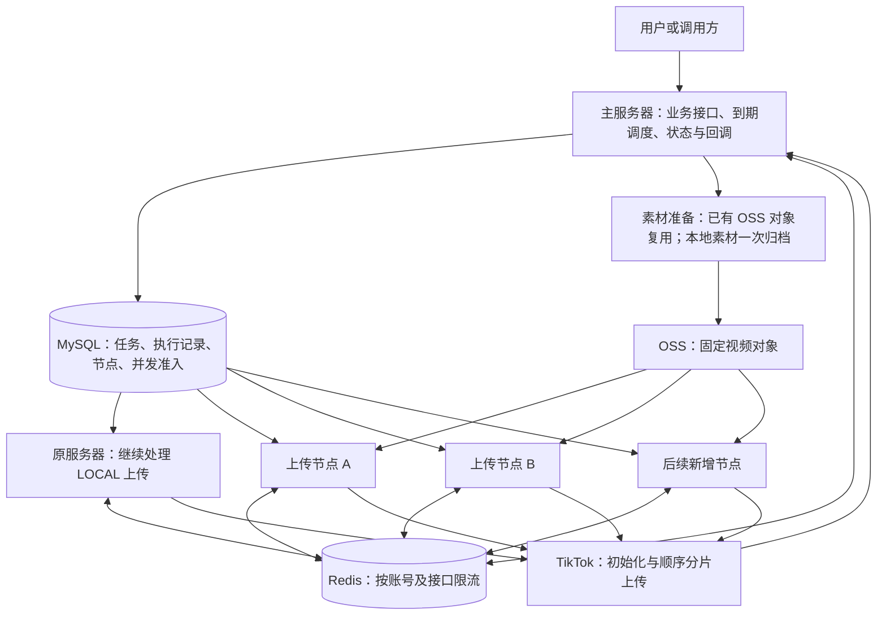
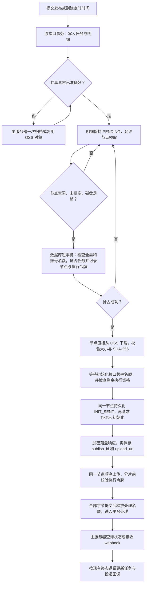
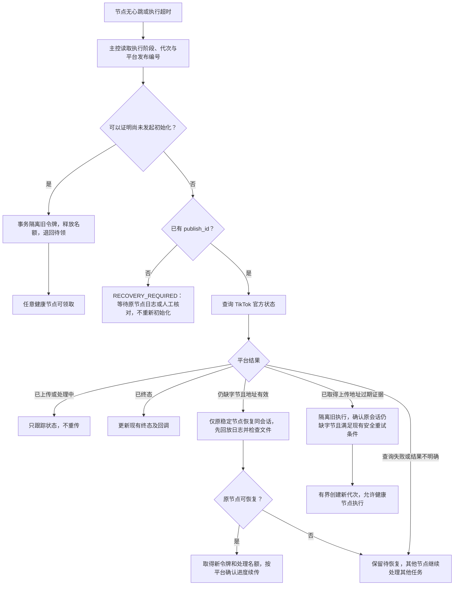

# TikTok 多服务器 FILE_UPLOAD 开发方案与流程图

> 状态：方案评审稿，未实施、未部署。编写日期：2026-10-22。
> 执行方式：确认方案后在当前会话逐项实施；本次只新增方案文档。开发前检查工作区并同步相关代码，保留字幕等无关修改。
> 2026-10-23 补充：[执行简版](2026-10-23-tiktok-upload-safe-rollout.md)确定第一期采用原服务器与新节点并行、仅分流指定新任务的方式；不立即把原服务器切成 CONTROL。

**目标：** 在现有项目内，将开放 API 的不同发布明细分配给多台服务器，各节点独立完成素材下载、初始化和上传，降低原服务器的大文件传输压力。

**架构：** 复用 Spring Boot、MySQL、Redis、OSS 和现有发布状态机。MySQL 是任务归属与并发准入的依据，Redis 负责接口频率限流。同一次上传会话固定在一个节点执行。

**技术栈：** 现有 Java/Spring Boot/MyBatis、MySQL、Redisson、现有 OSS 服务、systemd、Vue 3。

## 实施约束

- 采用用户确定的 FILE_UPLOAD 路线，OSS 作为节点取材源，不要求 TikTok 验证 OSS 域名。
- 第一阶段覆盖 tk_open_tiktok_publish_task/detail/attempt 链路，即发布中心展示的 Open API 队列。管理端 TkTiktokPublishServiceImpl 的独立上传链路继续在原服务器运行；如需将其一起扩容，另做适配，不能默认为已覆盖。
- 同一个明细的同一 attempt_no，由同一 worker_node_id 完成初始化和全部分片上传。
- 保留原有业务接口、业务状态、幂等键、attempt 历史、终态及回调去重语义；新字段和表采用增量迁移。
- 不新增独立业务项目，不改媒体生成架构，不引入新消息队列。
- 初次升级保持新任务分流关闭；关闭分流只改变未来任务的路线，已有 CLUSTER 执行保留原节点归属。运行模式必须显式配置，不能用线程数 0 表示禁用，现有代码会将线程数至少设为 1。
- 已有 publish_id 或 INIT_SENT 结果不明的任务不得因节点掉线直接重新初始化。
- 第一阶段不自动把仍有效的上传会话交给另一节点。跨 IP 接续同一上传会话不作为上线依赖。
- 官方指南仍要求服务端素材使用 PULL_FROM_URL；本文记录用户选定路线的技术实现，不声称该路线获得平台对具体应用的许可。

## 当前代码依据

以下路径均相对于产品源码根目录：
ruoyi-vue-pro-master/ruoyi-vue-pro-master/ruoyi-vue-pro-master/

| 已核对位置 | 当前能力或限制 |
| --- | --- |
| yudao-module-tk/src/main/java/cn/iocoder/yudao/module/tk/service/open/tiktok/TkOpenTiktokPublishService.java | 已有准备、上传、恢复执行池；submitAfterCommit、dispatchDueScheduled 会直接触发本机执行；resolveSource 优先本地素材；syncDetail/恢复链路可能触发续传 |
| yudao-module-tk/src/main/java/cn/iocoder/yudao/module/tk/service/open/tiktok/TkOpenTiktokPublishAttemptService.java | 已有事务抢占、owner_token、心跳、初始化前持久化保护、claimUpload、上传地址过期后有界重试 |
| yudao-module-tk/src/main/java/cn/iocoder/yudao/module/tk/service/open/tiktok/TkOpenTiktokPublishStatusJob.java | 同时承担到期调度、本机领取、状态查询、恢复、回调修复和本机日志回放，需要拆分职责 |
| yudao-module-tk/src/main/java/cn/iocoder/yudao/module/tk/service/open/tiktok/TkOpenTiktokPublishResponseJournal.java | 本机加密、落盘、fsync；当前回放要求 owner_token 一致，过期隔离后需要新增安全导入路径 |
| yudao-module-tk/src/main/java/cn/iocoder/yudao/module/tk/service/open/tiktok/TkOpenTiktokMediaService.java | 已有 OSS objectKey、文件大小和 SHA-256；定时发布还保存本机绝对路径 |
| yudao-module-tk/src/main/java/cn/iocoder/yudao/module/tk/service/open/tiktok/TkOpenTiktokConnectionTokenService.java | 已有 Token 刷新分布式锁和条件更新，继续复用 |
| yudao-module-tk/src/main/java/cn/iocoder/yudao/module/tk/framework/config/TkScheduleConfiguration.java | 全局启用 @Scheduled，WORKER 模式必须阻止无关调度器运行 |
| yudao-module-tk/src/main/java/cn/iocoder/yudao/module/tk/service/tiktok/TkTiktokMediaTransfer.java | 已有流式下载、分片传输、请求停止检查，继续复用 |

## 总体架构图



箭头表示请求或数据流方向。第一期原服务器继续处理 LOCAL，新节点主动从 MySQL 领取 CLUSTER；分流任务的视频由节点直接取材。各节点必须具备实际可用的上传出口；共用同一受限代理出口时，不能预期吞吐随节点数增长。

## 节点运行模式

| 模式 | 执行内容 |
| --- | --- |
| ALL_IN_ONE | 默认兼容模式，保留现有主服务和 LOCAL 本机上传；第一期保持此模式，与仅处理 CLUSTER 的新节点并行 |
| CONTROL | 后续可选模式，业务接口、素材归档、定时任务到期入队、平台状态查询、回调投递、过期执行检查、节点管理；不启动 Open API 大文件上传；第一期不切换 |
| WORKER | 任务领取、素材缓存、初始化与上传、原节点续传、本机响应日志回放、节点心跳；不运行生成、统计和其他业务调度 |

复用同一份 JAR。WORKER 模式使用 TkPublishWorkerRuntime 的受控计时线程，仅注册上述节点任务；不启用普通 @Scheduled 的全量任务扫描。修改 TkScheduleConfiguration 的生效条件，并检查是否还有其他 @EnableScheduling、Quartz、ApplicationRunner 或启动监听器会启动后台任务。WORKER 启动测试必须证明只运行白名单任务，不能只配置一个角色字段就认为隔离成功。

WORKER 的 Web 端口仅绑定 127.0.0.1，业务域名和 OAuth/回调入口继续指向主服务器。数据库、Redis、OSS 使用专用受限凭据及受保护网络；节点具备兼容的 Token/上传地址解密配置。

## 正常上传流程



素材未就绪时保持原业务状态并展示准备原因，不让节点领取后因读不到原机器路径而失败。素材准备失败执行有界重试并显示错误；来源已失效时留待修复，不能无限重试，也不能先调用 TikTok。

## 数据模型与抢占规则

### 复用现有表

- tk_open_tiktok_publish_task：继续作为业务任务汇总。
- tk_open_tiktok_publish_detail：继续作为一个目标账号的一条发布明细。
- tk_open_tiktok_publish_attempt：继续记录一次发布尝试及恢复依据。
- tk_open_tiktok_media：继续记录来源、文件大小、SHA-256 和现有 objectKey。

### 增量字段

在 tk_open_tiktok_publish_detail 增加 dispatch_pool（LOCAL/CLUSTER，默认 LOCAL），历史数据保留原服务器处理。只有未开始、素材可跨节点读取且有健康可用节点的新任务可进入 CLUSTER，否则新任务走 LOCAL。所有创建、定时、扫描、重试、同步及恢复入口检查该范围，领取事务再次验证；续传还必须校验原节点和执行令牌。暂停新任务分流不能自动重置已有 CLUSTER 执行。

在 tk_open_tiktok_publish_attempt 增加：

| 字段 | 类型建议 | 用途 |
| --- | --- | --- |
| worker_node_id | varchar(64)，可空 | 稳定节点身份；历史空值仅允许原服务器恢复 |
| worker_instance_id | varchar(64)，可空 | 进程启动 UUID，区分同一节点的前后进程 |
| upload_slot_held | tinyint，默认 0 | 是否占用集群处理名额 |
| account_slot_held | tinyint，默认 0 | 是否占用当前账号互斥名额 |
| upload_url_issued_at | datetime，可空 | 初始化响应记录时间 |
| upload_url_expires_at | datetime，可空 | 响应接收时间加一小时的估算值；不作为平台实际有效性的唯一证据 |
| confirmed_uploaded_bytes | bigint，默认 0 | 平台明确确认的字节数，不能使用本地已写出字节数冒充 |

继续保留 owner_token、attempt_no、heartbeat_time、file_sha256、file_size、upload_url_cipher。

新增索引：(worker_node_id, phase, heartbeat_time)，并核查处理名额统计和待领素材连接查询的 EXPLAIN；按实际执行计划补索引，不创建无关索引。

在 tk_open_tiktok_media 增加：

- publish_source_object_key：固定的、受本系统管理的发布素材对象。
- publish_source_status：LEGACY、ARCHIVING、READY、FAILED、CLEANED。
- publish_source_owner_token、publish_source_lease_until：防止归档进程重启后的旧执行覆盖新执行。
- publish_source_error：可展示的脱敏准备错误。

文件大小和 SHA-256 复用现有字段。若原字段有值必须一致；若无值，准备阶段读取文件计算后在归档成功的条件更新中补齐，不能只用 ETag 代替内容校验。发布对象使用唯一对象键且应用不覆盖；下载再次验证内容。

### 新增两张小表

**tk_open_tiktok_publish_node**

- node_id：唯一节点名，例如 upload-01。
- active_instance_id：当前进程 UUID。
- enabled、draining：是否启用、是否停止领取新任务。
- max_concurrency：管理员指定的节点上限，不得超过本机配置硬上限。
- last_heartbeat_time：数据库时钟写入。
- software_version、last_error：版本和最近错误。
- 同名节点若已有新鲜心跳，第二个进程注册失败；不能悄悄顶替。
- 在途数量以执行记录统计为准，节点自报指标仅供观测。

**tk_open_tiktok_publish_gate**

- gate_key：唯一键，GLOBAL 或 ACCOUNT 加账号身份摘要。
- scope_type、capacity、update_time：并发范围和容量。
- GLOBAL 初始容量为 2；同一开发者应用下同一 TikTok open_id 的 ACCOUNT 容量为 1。
- 不以 connection_id 代替真实账号身份，防止同一账号通过不同连接绕过限制。

### 并发准入事务

新增 TkOpenTiktokPublishAdmissionService.tryClaim(detail, node)：

1. 使用 READ_COMMITTED 短事务，固定锁顺序：GLOBAL gate → ACCOUNT gate → task → detail → attempt。
2. 读取已持有名额的执行记录；达到全局或账号上限时直接返回，不在事务内等待。
3. 复用现有 attemptService.claim 的状态和代次检查，条件写入 node/instance/owner_token，同时设置两个名额标志。
4. 提交后才下载或发起任何网络请求；失败或未抢到立即释放本机预留位。
5. 名额释放通过原代次与执行令牌的条件更新，重复释放无影响。释放路径不反向取得 gate 锁，避免锁顺序倒置。
6. TTL 到期不能直接认为名额空闲。看门狗隔离旧执行，确认无在途网络调用后回收处理名额；初始化结果不明时账号名额继续保留。

数据库负责耐重启的并发计数，Redis 丢失不会把执行中的任务当成零。Redis 限流状态丢失时原子创建新的限流世代，集群共享至少 60 秒冷却窗口，不能重置后立即放满请求。所有接口调用包括重试、人工同步和进度核对都必须经过该入口。

所有租约和名额判断使用同一数据库时钟，应用及 JDBC 会话的日期解释与现有北京时间字段保持一致；不可混用各机器的 LocalDateTime.now。终态确认、安全退回及过期创建新代次都要条件释放旧代次持有的名额，不能遗留历史占用。

## 素材准备与清理

新增 TkOpenTiktokPublishSourceService：

- 已有本系统 OSS 对象：HEAD 校验并引用，避免重复下载和上传。
- 已有本地素材：主服务器验证受管理路径后，一次归档到 OSS 发布命名空间。
- 外部 URL：在原地址有效时保存固定副本；沿用现有 URL 校验、大小限制、重定向安全检查。所有跳转及解析地址仍需防止访问内网。
- 已过期外部 URL 但原服务器有本地副本：从受管理本地副本归档；两者都不可用时展示素材缺失。
- 归档使用源记录租约和条件更新；网络下载、OSS 上传放在数据库事务外。
- 定时任务使用固定发布副本，保留到所有相关任务终结并经过保留期，不能依赖原签名 URL 在未来仍有效。
- WORKER 的缓存按 mediaId 加 SHA-256 管理，每台独立；不能把本机缓存路径写回共享素材路径，缓存清理只清本机目录。
- 主服务器清理共享对象前确认没有待执行、执行中、待恢复和定时引用。取消或结束其中一个任务不能删除其他任务仍需使用的视频。
- 归档对象按所有权区分：新建发布副本可按规则删除；引用已有对象不得因本功能结束就直接删除原对象。

当前 TkOpenTiktokMediaService 的定时本地准备和终态清理路径要与新逻辑协调，集群任务不再提前下载到主服务器再重复归档。首批先用已有 OSS 对象验证，历史本地素材分批准备。

## 限流、心跳及初始参数

以下均为新方案的初始建议值，不代表当前线上配置：

| 参数 | 初始值 | 说明 |
| --- | --- | --- |
| worker poll | 2 秒，加随机抖动 | 空闲时领取；无名额不持续扫描 |
| 节点心跳 | 20 秒 | 供展示和节点登记 |
| 节点离线阈值 | 90 秒 | 仅标记离线，不直接重发任务 |
| 执行心跳 | 20 秒 | 复用现有频率 |
| 执行租约 | 180 秒 | 改为可配置；租约判断统一数据库时间 |
| 节点硬上限 | 2 条 | 下载、上传、续传合计不超过该值 |
| 集群处理名额 | 2 条开始 | 后续按实测提高到 4 等；没有容量收益实测前不按机器数自动相乘 |
| 同账号处理名额 | 1 条 | 初始化结果不明时保留账号隔离 |
| 初始化请求预算 | 每账号每分钟 5 次 | 给官方 6 次/分钟上限留余量；重试也计入 |
| 状态请求预算 | 每账号每分钟 20 次 | 低于官方 30 次/分钟；上传校对、人工同步和定时查询共享预算 |
| 分片请求硬超时 | 120 秒 | 包含网络调用的总截止时间，需确认底层取消真正生效 |
| 共享素材准备并发 | 1 | 保护原服务器磁盘和 OSS 链路 |

一个本机处理位从领取前持有至上传阶段结束，准备和恢复均计入；没有无限内存等待队列。等待限流时继续心跳并设置等待截止，初始化前尚无远端副作用的工作可退回队列。

Token 刷新沿用 TkOpenTiktokConnectionTokenService 的分布式锁。频率限流按开发者应用、真实账号及接口维度共享；不能按节点或租户分别计数后合并超限。

## 故障恢复流程



### 必须实现的恢复细节

1. 同一稳定节点重启后进程 UUID 改变，先回放本机日志，再按租约规则取得新执行权。所有请求前和每个分片前重新核验执行权；失去 DB/限流能力时不继续发新请求。
2. 旧节点的在途 HTTP 请求可能继续完成。修改 owner_token 只能阻止后续请求及旧结果写入，不能撤销已发出的网络操作。必须有真实的请求硬超时和恢复等待，不能承诺仅靠数据库锁实现远端严格一次。
3. 现有 journal.replay 因 owner_token 改变可能一直跳过。新增 importRecordedResponse：锁定同一 detail/attempt_no，核对源节点和日志身份；无冲突时只导入 publish_id/加密上传地址，不恢复旧执行令牌；发现已有不同 publish_id 或更新代次时留存日志并告警，不能覆盖。
4. 无 publish_id 且 INIT_SENT 的任务缺少官方查询标识；不能宣称只调用状态接口就一定能恢复。原节点日志不可用时保留待核对。
5. 续传必须满足 worker_node_id 相同、文件大小和 SHA-256 相同，按 TikTok 已确认字节继续。原节点更换出口后同样要按跨 IP 不确定情况处理，不能只看机器名相同。
6. 已取得上传地址过期证据，并确认原会话未完成、满足当前安全重试逻辑时，才创建新 attempt_no。旧 attempt、publish_id 和错误证据保留；不得仅因本地估算过期就重发。
7. OSS 下载 403、业务接口 403 和 TikTok upload_url 过期必须区分，素材权限错误不能触发重新发布。
8. 原节点永久丢失时，不保证该节点所有在途会话自动恢复；其他节点仍可处理新任务。上传地址过期后仅按安全条件决定新代次；结果不明继续隔离。

## 需要修改和新增的文件

以下路径相对产品源码根目录；文件名为拟定实现位置，未新增业务代码。

### 修改

| 文件 | 改动 |
| --- | --- |
| yudao-module-tk/src/main/java/cn/iocoder/yudao/module/tk/framework/config/TkScheduleConfiguration.java | WORKER 不启用全量业务调度 |
| yudao-module-tk/src/main/java/cn/iocoder/yudao/module/tk/service/open/tiktok/TkOpenTiktokPublishService.java | 主控不本机上传；任务创建、定时激活、人工 resume、状态恢复等入口全部按角色处理；接入名额、共享素材、节点约束 |
| yudao-module-tk/src/main/java/cn/iocoder/yudao/module/tk/service/open/tiktok/TkOpenTiktokPublishAttemptService.java | 在现有抢占、心跳和恢复中增加节点、实例、名额及数据库时钟；新增安全响应日志导入 |
| yudao-module-tk/src/main/java/cn/iocoder/yudao/module/tk/service/open/tiktok/TkOpenTiktokPublishTerminalService.java | 终态事务内释放当前代次名额，保留现有状态与回调去重保护 |
| yudao-module-tk/src/main/java/cn/iocoder/yudao/module/tk/service/open/tiktok/TkOpenTiktokPublishStatusJob.java | 主控负责平台查询等控制任务；工作节点计时由专用 Runtime 管理 |
| yudao-module-tk/src/main/java/cn/iocoder/yudao/module/tk/service/open/tiktok/TkOpenTiktokPublishResponseJournal.java | 日志加入节点及实例身份，保留隔离后的安全导入，不清理尚未核对的响应 |
| yudao-module-tk/src/main/java/cn/iocoder/yudao/module/tk/service/open/tiktok/TkOpenTiktokMediaService.java | 接入固定发布素材，协调定时素材准备及删除 |
| yudao-module-tk/src/main/java/cn/iocoder/yudao/module/tk/service/cleanup/TkScheduledMediaCleanupService.java | 共享引用与本机缓存分开清理，保护在途及恢复任务 |
| yudao-module-tk/src/main/java/cn/iocoder/yudao/module/tk/dal/dataobject/openapi/TkOpenTiktokPublishAttemptDO.java | 增量执行字段 |
| yudao-module-tk/src/main/java/cn/iocoder/yudao/module/tk/dal/dataobject/openapi/TkOpenTiktokMediaDO.java | 增量共享素材字段 |
| yudao-module-tk/src/main/java/cn/iocoder/yudao/module/tk/dal/mysql/openapi/TkOpenTiktokPublishAttemptMapper.java | 节点归属、名额统计、按原节点选择续传 |
| yudao-module-tk/src/main/java/cn/iocoder/yudao/module/tk/dal/mysql/openapi/TkOpenTiktokPublishDetailMapper.java | 只选可迁移素材及允许的发布范围，保留现有公平调度 |
| yudao-module-tk/src/main/java/cn/iocoder/yudao/module/tk/controller/admin/tiktok/TkOpenTiktokPublishQueueController.java | 节点查询、排空、限额接口；保留现有接口签名 |
| yudao-module-tk/src/main/java/cn/iocoder/yudao/module/tk/controller/admin/tiktok/vo/TkOpenTiktokPublishQueueVO.java | 增加节点、阶段、确认进度和恢复原因展示字段 |
| yudao-ui/yudao-ui-admin-vue3/src/api/tk/videoPublishCenter/index.ts | 新增节点管理 API 和可选展示字段 |
| yudao-ui/yudao-ui-admin-vue3/src/views/tk/video-publish-center/index.vue | 队列显示执行节点和节点状态，增加停止领取操作 |

如现有 TkTiktokMediaTransfer 的总超时和取消不足，只在该文件补齐上传边界；不借机修改无关生成服务。

### 新增

在 yudao-module-tk/src/main/java/cn/iocoder/yudao/module/tk/service/open/tiktok/ 下：

- TkOpenTiktokPublishClusterProperties.java：模式、节点和时间参数，启动校验。
- TkOpenTiktokPublishNodeService.java：注册、心跳、排空、硬上限校验和同名节点保护。
- TkOpenTiktokPublishAdmissionService.java：数据库准入、名额回收和代次一致性。
- TkOpenTiktokPublishRateLimiter.java：共享接口预算，Redis 异常时保守停止。
- TkOpenTiktokPublishSourceService.java：固定素材及独立缓存。
- TkPublishWorkerRuntime.java：仅 WORKER 运行的受控计时与优雅退出。

数据对象及 Mapper 位于 yudao-module-tk/src/main/java/cn/iocoder/yudao/module/tk/ 下：

- dal/dataobject/openapi/TkOpenTiktokPublishNodeDO.java
- dal/dataobject/openapi/TkOpenTiktokPublishGateDO.java
- dal/mysql/openapi/TkOpenTiktokPublishNodeMapper.java
- dal/mysql/openapi/TkOpenTiktokPublishGateMapper.java

配置和脚本：

- yudao-module-tk/src/main/resources/sql/tk_open_tiktok_publish_cluster_upgrade_mysql.sql
- yudao-server/src/main/resources/application-publish-worker.yaml
- 工作区 deploy/systemd/tk-publish-worker@.service
- 工作区 deploy/README_TIKTOK_PUBLISH_CLUSTER.md

没有计划删除的文件。

## 运维接口和页面

新增接口均位于主服务器，需要对应查询或管理权限：

| 接口 | 输入和行为 |
| --- | --- |
| GET /tk/open-tiktok-publish/queue/nodes | 返回节点在线、排空、版本、处理数量、硬上限、最近心跳与错误 |
| POST /tk/open-tiktok-publish/queue/nodes/drain | body 为 nodeId、draining；只停止新领取，不中断已有上传和续传 |
| POST /tk/open-tiktok-publish/queue/nodes/concurrency | body 为 nodeId、limit；不得超过节点启动硬上限 |
| POST /tk/open-tiktok-publish/queue/cluster/concurrency | body 为 limit；降限时等待已有任务释放，不主动杀上传 |

现有 summary/details 增加可选字段，不删除旧字段；新管理接口具备管理权限和操作审计。现有 resume 继续返回整数，本机不提交时返回 0；页面文案调整为“已触发队列检查，上传节点将领取任务”，不能把 0 解读为队列恢复失败，也不伪造本机已提交数量。

页面先复用现有发布中心，不新建独立运维系统。暂停领取与取消发布是不同操作；节点排空不会取消已获用户授权的任务。

## 可执行开发任务

### Task 1：兼容开关与数据库迁移

- [ ] 新增 ClusterProperties、Node/Gate DO 与 Mapper、增量 SQL和 dispatch_pool；首次升级默认 cluster.enabled=false、dispatch.enabled=false、runtime-mode=ALL_IN_ONE。上线后暂停分流使用 dispatch.enabled，不能由关闭开关抹去在途任务的节点归属。
- [ ] 验证老数据空节点、空源字段可读，uk_detail_attempt 不改变；只做增量结构，不重写历史状态。
- [ ] 增加 TkOpenTiktokPublishClusterSchemaTest 和启动参数验证测试。
- [ ] 完成标志：首次升级且分流关闭时现有发布测试仍通过，迁移 SQL 能在测试数据库应用并校验结构；已有 CLUSTER 执行不因停止分流而丢失归属。

### Task 2：运行角色和工作节点生命周期

- [ ] 新增 NodeService、TkPublishWorkerRuntime；修改 ScheduleConfiguration 和 StatusJob 的注册条件。
- [ ] 找出本功能直接触及的提交、定时、待处理扫描、重试、同步及恢复入口，ALL_IN_ONE 只领取 LOCAL、WORKER 只领取 CLUSTER，并在领取事务内复核。后续 CONTROL 模式禁止任何 Open API 大文件上传副作用，包含状态查询触发的续传。
- [ ] WORKER 只注册白名单计时任务；检查启动监听器、普通调度和 Quartz 是否意外运行。
- [ ] 增加 TkOpenTiktokPublishRuntimeRoleTest、TkOpenTiktokPublishNodeServiceTest：验证重复 node_id、实例替换、排空、节点离线。
- [ ] 完成标志：原服务器和新节点不会越过各自领取范围，WORKER 不运行其他业务 Job，原单机模式行为可用；后续 CONTROL 不上传。

### Task 3：可跨节点读取的固定素材

- [ ] 新增 SourceService；优先引用已有 OSS 对象，必要时从本地受管理文件或有效外部 URL 归档。
- [ ] 只给 READY 素材放行领取，归档失败原因可见，定时任务不依赖过期源链接。
- [ ] 修改媒体清理和终态清理，引用对象与新建副本分开管理；本机缓存不写入共享路径。
- [ ] 增加 TkOpenTiktokPublishSourceServiceTest：覆盖旧本地路径不存在、签名过期、有本地副本、大小/校验不符、跨任务共享引用。
- [ ] 完成标志：两个不同缓存目录的节点能读取同一素材；结束一条任务不会破坏另一条。

### Task 4：事务抢占、并发名额与接口限流

- [ ] 新增 AdmissionService 和 RateLimiter，接入现有 claim、分片前检查及恢复上传。
- [ ] 所有准入使用固定锁顺序、最新提交数据和本机容量预留，网络请求不放在 DB 事务内。
- [ ] 下载与上传、正常与恢复任务合计受本机和全局上限约束。
- [ ] 增加 TkOpenTiktokPublishAdmissionServiceTest 和 TkOpenTiktokPublishRateLimiterTest，并以独立数据库连接做真实并发验证。
- [ ] 完成标志：两个节点竞争同一明细仅一个抢到；全局上限 2、账号上限 1 在并发请求下不突破；Redis 重启后不把 DB 执行占用归零。

### Task 5：按节点执行上传及安全恢复

- [ ] 修改 PublishService/AttemptService，初始化和全部分片固定原节点，上传结果保持现有终态处理。
- [ ] 将主控平台状态判断与实际续传拆开；主控只标记原节点待恢复，WORKER 仅领取自己的续传。
- [ ] 新增安全 journal 导入，丢失旧执行令牌后仍可保留并核对官方响应，但绝不恢复旧执行权。
- [ ] 为分片设置有效硬超时，旧执行隔离后的结果更新使用条件写入。
- [ ] 扩展已有 ExecutionTest、AttemptServiceTest、ResponseJournalTest、StatusJobTest，增加 TkOpenTiktokPublishClusterRecoveryTest。
- [ ] 完成标志：INIT_SENT 无编号不自动重发；已有编号不重复初始化；异节点不能自动接续有效旧会话；过期重试保留完整历史。

### Task 6：节点观测与操作

- [ ] 第一期复用现有发布中心，使用受控配置、日志和队列记录核对节点在线/排空、处理数量、版本、归属、阶段及待恢复原因，不新增页面。
- [ ] 后续按需增加节点 API、权限和操作审计，再接入现有页面。
- [ ] 概览统计从 DB 读取，避免节点自行报告的数量与队列真实记录冲突。
- [ ] 第一期验证排空行为；后续节点 API 增加时补齐权限测试，验证权限不足无法调整限额。
- [ ] 完成标志：能通过日志和队列记录核对节点工作情况；排空不再领取新任务，在途任务继续处理或保留明确恢复状态。

### Task 7：双节点验证、部署材料及回退演练

- [ ] 新增独立 systemd 模板与无凭据配置样例；上传节点不依赖模型、ASR 或 Python 视频生成环境。
- [ ] 在隔离数据库及可控上传服务中测试宕机、网络分区、DB 不可用、Redis 重启、源过期、回调重复和回调先到。
- [ ] 使用明确授权的真实任务分别验证两个节点的完整 TikTok 会话；真实发布验证不批量复制同一内容到生产账号。
- [ ] 记录同批代表性素材的单节点与双节点吞吐、P95 上传时间、排队时长、失败率、资源及流量；是否达到扩容目标由这些结果决定。
- [ ] 完成标志：所有验收项通过，有可执行发布步骤和回退记录；未获部署指令前不执行生产迁移或服务重启。

## 验证命令与验收矩阵

后端命令在产品源码根目录执行，使用仓库指定 Maven。实现时测试类按上述任务新增，命令不代表本次已运行：

```powershell
..\..\..\.runtime\apache-maven-3.9.10\bin\mvn.cmd -pl yudao-module-tk -am -Dtest=TkOpenTiktokPublish*Test,TkOpenTiktokMediaServiceTest -Dsurefire.failIfNoSpecifiedTests=false test
```

前端在 yudao-ui/yudao-ui-admin-vue3 执行：

```powershell
..\..\..\..\..\.runtime\npm-global\node_modules\.bin\pnpm.cmd ts:check
```

| 场景 | 必须观察到的结果 |
| --- | --- |
| 两节点同时领取同一明细 | 一个当前执行令牌，一个有效初始化执行者 |
| 集群名额 2、单节点 2 | 三台节点同时扫描也不超过集群处理名额 |
| 同账号多个连接 | 不绕过账号互斥和接口频率预算 |
| Redis 不可用或清空 | 暂停新接口调用并保守恢复限流；执行名额仍由 DB 保留 |
| DB 失联但 TikTok 可达 | 不发送下一分片或新初始化；在途请求有截止时间 |
| 初始化前节点宕机 | 确认未发出初始化，隔离旧执行后可由其他节点领取 |
| 初始化请求已发、响应未入库 | 不重新初始化；原节点日志导入不覆盖更新代次 |
| 上传部分字节后原节点重启 | 同节点校验相同文件，依据平台进度恢复；不新建发布 |
| 原节点永久离线 | 其他任务继续；该会话按恢复/过期安全条件处理，不虚报恢复成功 |
| TikTok 上传地址过期 | 仅在官方状态与现有重试规则允许时新建代次；达到上限停止 |
| OSS 403 | 素材错误，不触发新发布代次 |
| callback 重复或早于数据库响应保存 | 终态与回调幂等，不回退状态 |
| 节点排空 | 不再领取新任务，已有任务继续完成 |
| 一个媒体被两条任务引用 | 第一条结束不删除第二条需要的素材 |
| 主控状态同步 | 不在主控启动实际续传 |

以上并发事务和网络故障不能只靠 Mock 单元测试证明；需要真实 MySQL 多连接及可控网络集成测试。真实 TikTok 试点验证可用性，但不证明所有故障时刻都严格一次。

## 配置示例

以下配置项为拟新增项，不能直接用于当前未改造程序：

```yaml
tk:
  open-api:
    publish:
      cluster:
        enabled: true
        runtime-mode: WORKER
        node-id: upload-01
        node-hard-limit: 2
        poll-ms: 2000
        heartbeat-seconds: 20
        lease-seconds: 180
        cross-node-resume-enabled: false
      worker-count: 2
      upload-worker-count: 2
      recovery-worker-count: 1
      journal-directory: /data/tk-publish/journal
server:
  address: 127.0.0.1
```

recovery-worker-count 是线程池参数，不能突破本机总名额 2。运行模式、缓存/日志路径、网络连接和密钥来自节点外部配置；示例不包含凭据。生产实际路径需部署前核实，上传节点使用独立目录和服务名。

## 上线与回退流程

1. 开发前同步最新代码，确认现有无关修改；生产现状、源码版本、线上配置和网络出口先做只读核对。
2. 备份数据库和原程序、配置，在测试环境确认增量迁移的锁影响；规划升级窗口，停止领取并等待在途上传完成，历史未决执行保留记录和原节点归属。
3. 应用迁移并发布新程序，保持新任务分流关闭、ALL_IN_ONE；验证原上传、任务、定时、回调和原节点日志恢复正常。单实例升级通常需要一次计划内重启，不能据此承诺零中断。
4. 首批仅选择已有固定 OSS 对象的新任务，历史任务继续 LOCAL，不自动迁移。
5. 保留原服务器的 LOCAL 上传能力，部署一台只领取 CLUSTER 的新节点，本机并发 1；共享全局上限先以实施时核对的现有限额为起点。
6. 开启指定范围的新任务分流，核对 task/detail/attempt、平台真实发布结果和旧任务前进情况；检查主接口、数据库及共享出口负载。
7. 验收通过并观察完整业务高峰及定时周期后，增加第二个节点，每台先 1；检查是否共用受限出口。
8. 再按实测逐步调整分流比例和总并发，每次只扩大一个维度；测量排队、上传、平台处理三种耗时，平台处理本身不因扩容自动缩短。第一期不切换 CONTROL。
9. 每次发布按备份、完整制品 SHA-256、原子切换、指定服务重启、PID/端口/HTTP/日志检查执行，不影响其他项目。

回退：

- 先关闭新任务分流，后续任务走 LOCAL，再将新节点排空、不再领取新任务；已有上传继续按原节点执行或恢复，不能直接改回 PENDING。
- 只有在数据库隔离旧执行、确认从未发出初始化请求后，才允许将未开始的 CLUSTER 任务改为 LOCAL，由同版本原服务器执行；已有 publish_id 或 INIT_SENT 结果不明的任务先核对平台，不直接改归属。
- 保留新增表和历史记录，不做破坏性回退 SQL。
- 功能回退优先保留新版本程序并关闭新任务分流；若确需回退旧二进制，必须先处理节点归属与未决会话，避免旧程序忽略新约束后抢占。
- 原服务器模式回退后核对队列完整性、近期前进情况和待恢复记录，三者分别报告。

## 初始资源、收益与工作量

- 新节点可用 4 核、8GB 内存、50～100GB 缓存磁盘作为试点估算，不要求 GPU。
- 缓存磁盘按最大视频体积、并发、保留数量和预留空间计算；低于安全余量时停止领取，不靠磁盘写满后报错。
- 上传带宽、OSS 下载链路和代理总出口必须测量。多机扩容主要提升不同任务并行吞吐，不保证单视频更快或两台恰好两倍。
- 新节点共享 MySQL/Redis，连接池按小规模配置，总连接数纳入主库容量；节点增加后检查扫描 SQL、锁等待和心跳写入。
- 视频传输费用包含 OSS 到节点和节点到 TikTok；对于跨地域取材，还要计入跨地域费用。
- 预计 6～9 个工程工作日完成开发、集成故障测试和小规模试点，属当前代码基础上的估算；服务器网络准备和平台结果等待可能额外耗时。

## 官方接口依据与已知边界

- FILE_UPLOAD 初始化后使用返回的 upload_url；URL 签发后一小时内完成上传。估算截止时间不能代替真实平台结果。
- 同一视频分片按顺序上传；多节点分担不同任务。
- 初始化接口每用户 Token 每分钟 6 次，状态查询每分钟 30 次；跨节点共享预算。
- 所查文档未明确保证跨 IP 接续同一上传会话，第一阶段关闭该能力。
- 官方指南要求服务端素材使用 PULL_FROM_URL；本方案按用户确定的 FILE_UPLOAD 方向设计，保留这一已知平台规则边界。

资料核对日期：2026-10-22。

- [Direct Post](https://developers.tiktok.com/docs/en/content-posting-api-reference-direct-post)
- [Media Transfer Guide](https://developers.tiktok.com/docs/en/content-posting-api-media-transfer-guide)
- [Get Post Status](https://developers.tiktok.com/docs/en/content-posting-api-reference-get-video-status)
- [Content Sharing Guidelines](https://developers.tiktok.com/docs/en/content-sharing-guidelines)

## 开发确认范围

确认后按 Task 1～7 在本项目内实施，优先最小变更、复用当前上传与恢复逻辑，输出变更 diff；生产部署和真实发布验证需对应执行指令。本稿不表示已完成开发、压测或上线。

