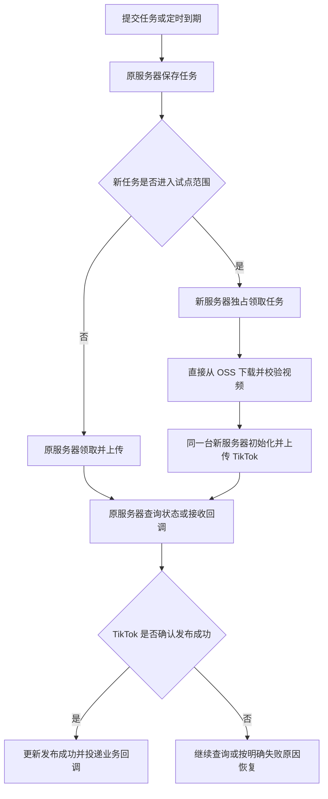

# TikTok 多服务器上传：执行简版

> 2026-10-23，方案稿。尚未修改业务代码、部署服务器或执行真实发布。
> 本文确定第一期执行顺序；[详细技术设计](2026-10-22-tiktok-multi-server-file-upload.md)作为开发参考。

采用“原服务器继续工作，新上传服务器逐步分担”的方式。第一期只分担现有 Open API 发布队列的上传，不迁移其他业务和独立管理端上传链路。前端操作、业务接口、生成流程、定时发布入口和回调入口继续保留。

## 谁负责什么

| 位置 | 职责 |
| --- | --- |
| 原服务器 | 接收任务、定时调度、原有上传、查询 TikTok 状态、接收回调 |
| 新服务器 | 领取分配给自己的任务，直接下载 OSS 视频，完成 TikTok 初始化与全部分片上传 |
| 现有 MySQL / Redis | 保存任务和节点归属、控制并发及接口频率；不新增消息队列 |

新服务器自己从 OSS 取视频，再传给 TikTok，走 FILE_UPLOAD，不使用 TikTok 从 OSS 拉取的方式。OSS 仍需允许新服务器授权访问，但不依赖 TikTok 验证 OSS 域名。

## 具体执行

| 顺序 | 做什么 | 通过条件 |
| --- | --- | --- |
| 1 | 同步代码，在隔离环境记录原发布流程、队列完整性和性能基线 | 已定位原上传、定时、重试、恢复入口；生产不做修改 |
| 2 | 增加上传节点模式、任务分流开关和数据库领取保护，默认关闭新任务分流 | 历史任务默认归原服务器；原接口及原功能回归通过 |
| 3 | 测试两台机器抢同一任务、断网、宕机、上传地址过期和回调重复 | 不因节点竞争重复初始化；任务不丢，异常原因和恢复记录可查 |
| 4 | 获得部署指令后，备份程序/配置/数据库；核对迁移锁影响，安排升级窗口，先停止领取并等在途上传完成 | 新代码上线但分流仍关闭，验证原上传、定时和回调能继续工作 |
| 5 | 增加 1 台上传服务器，每次只处理 1 条，仅分配少量指定的新任务 | 实际平台发布成功；旧任务持续推进，主服务和数据库指标未越过事先确定的基线阈值 |
| 6 | 试点通过后增加第二台，再逐步增加分流比例和并发 | 先观察一个完整业务高峰及定时周期；每次只扩大一个维度 |

第一期不做新管理页面，复用现有发布中心查看结果，节点归属和故障通过日志及队列记录核对。配置与运行代码需要少量改动，单实例后端升级通常需要一次计划内重启，不能承诺完全无中断。

## 流程图

图中每个任务只走一条上传路线。只有素材已能被新服务器读取的未开始任务可以分流；历史任务和已开始的上传保持原有归属。

## 开发必须守住的四条规则

1. **分清领取范围。** 发布明细增加 `dispatch_pool=LOCAL/CLUSTER`，历史数据和默认值为 LOCAL。原服务器只领取 LOCAL，新节点只领取 CLUSTER。仅在有健康可用节点且共享素材就绪时分流，否则新任务走 LOCAL。创建、定时、待处理扫描、重试、手动同步和恢复入口都检查范围，最终数据库抢占事务再次验证。不得只在定时扫描入口过滤。
2. **一次上传固定一台机器。** 初始化、分片、续传使用同一节点；保留现有 attempt、执行令牌、心跳和初始化前落库保护。下载完成后再初始化，避免提前消耗上传地址有效期。
3. **原服务器与新节点共享上限。** 同一账号并发先设 1，新节点并发先设 1，全局上限以实施时核对的现有限额为起点；不能按机器数直接倍增。工作节点只运行上传必要任务，使用有限连接池、缓存和下载缓冲；控制数据库、Redis、OSS 与代理出口的新增负载。
4. **发布结果有依据。** 完成字节上传只进入平台处理中；直发以 TikTok 返回 `PUBLISH_COMPLETE` 为成功依据。已有发布编号或初始化结果不明时先核对，禁止故障后直接重新发布。无法自动确认的任务保留待恢复状态并可查原因。

## 有问题怎么退回

- 关闭“新任务分流”，后续任务走原服务器；没有健康可用新节点时自动停止分流。新节点停止领取新任务，已开始任务按原节点继续或恢复。
- 需要退回原服务器的 CLUSTER 任务，先在数据库中隔离旧执行，再确认从未发出初始化请求，才允许改为 LOCAL。已有发布编号或初始化结果不明的任务不直接改归属。
- 新节点掉线时任务保留在数据库；优先恢复原节点及其日志，再核对平台结果。第一期不自动跨机器续传有效会话。
- 功能退回保留兼容的新版本和新增字段；不能直接换回忽略节点归属的旧程序。

## 验收标准

- 原上传、视频生成、定时任务、页面和回调回归通过；旧任务记录完整且持续推进。
- 新节点完成经过授权的真实发布，平台状态或事件明确确认成功。
- 双节点竞争、宕机和重试验证中，无重复初始化、记录丢失或素材被提前清理；不确定状态有明确处理出口。
- 主接口延迟、数据库锁等待、错误率及旧任务排队时长，与上线前基线比较满足约定阈值。
- 演练关闭分流：后续任务回到原服务器，在途任务的归属和状态保持正确。

这是降低现有程序受影响风险、保证任务可追踪与可恢复的方案。TikTok 审核、账号授权、平台限制及网络故障仍可能导致失败或等待，不能承诺 100% 发布成功。

接口依据：[Direct Post](https://developers.tiktok.com/docs/en/content-posting-api-reference-direct-post)、[Media Transfer Guide](https://developers.tiktok.com/docs/en/content-posting-api-media-transfer-guide)、[Get Post Status](https://developers.tiktok.com/docs/en/content-posting-api-reference-get-video-status)。技术约束已于本次会话核对。
