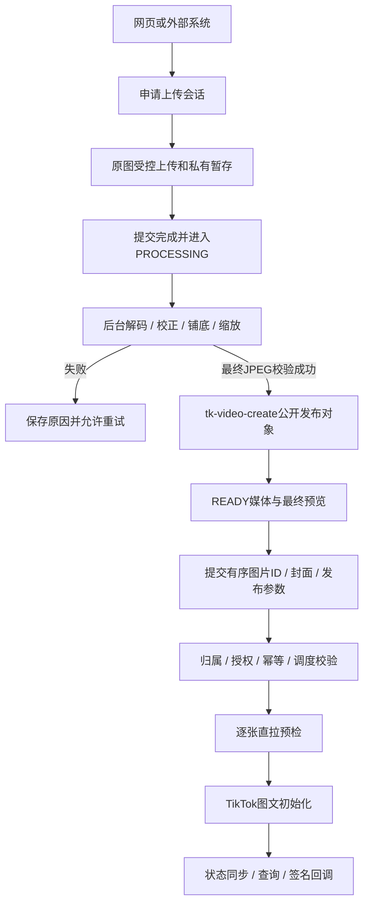

# 图文发布 OpenAPI 与多格式图片上传合并方案

日期：2026-11-12（Asia/Shanghai）。本文件为合并设计，尚未实现或上线这些新增能力。用户已确认开发意向，本轮要求先输出统一方案。

# 一、需求理解

目标：外部系统像调用现有视频 OpenAPI 一样上传图片、创建图文发布任务、查询结果与接收回调；网页和 OpenAPI 同时支持 JPEG、WebP、PNG、GIF、HEIC/HEIF。

问题：现有 OpenAPI 只处理单视频；网页图文依赖浏览器把 JPEG/WebP 转成 JPEG，无法覆盖外部调用与所有 HEIC 使用场景。需要共用的服务端图片转换能力，并保持已有双桶存储、客户端隔离及初始化防重。

统一输入规则：每篇1–35张，每张原文件最多20MiB；发布图为 JPEG，最长边不超过1920、短边不超过1080，不放大小图。照片顺序和封面由调用方指定并持久化。

| 原格式 | 规范化行为 |
| --- | --- |
| JPG/JPEG | 校正方向、按需缩放并输出 JPEG |
| WebP | 输出静态主帧 JPEG |
| PNG | 合成白色背景、输出 JPEG |
| GIF | 读取第一显示帧，合成白色背景、输出静态 JPEG |
| HEIC/HEIF | 解码主图、校正方向、转到 sRGB 并输出 JPEG |

GIF、动画 WebP 和多图 HEIF 不展开为多张，不保留动画或 Live Photo 视频。预览必须显示实际规范化结果，并明确提示静态处理。最终 JPEG 再检查真实格式、尺寸和字节大小，输出超过限制则明确失败。

# 二、需要增加的内容

## 产品功能

- 多格式上传、异步转换与状态查询；转换成功才成为 READY 媒体。
- 有序多图任务、封面、标题/描述、评论、自动推荐音乐、商业及 AIGC 标记。
- 直接发布、发送收件箱；定时直接发布复用现有受支持的账号数量和调度规则。
- 任务/账号明细查询、签名回调、受控重试与初始化结果核查。
- 不扩展图片远程 URL 快捷发布；第一版调用方先完成文件上传。

## 前端

- 发布页选择器支持上述格式，展示上传/转换/失败/成功，独立重试失败图片。
- 预览和封面基于最终 JPEG；图片转换未完成时不允许提交任务。
- 网页沿用后台登录鉴权；外部系统沿用 OpenAPI 鉴权，二者共用转换服务但不混用账号/媒体 ID。
- 网页增加后台异步入口：POST `/tk/tiktok-publish/media/photo/uploads`接收单张原图并返回上传会话；GET同路径`/{uploadId}`查询转换状态与成功后的后台媒体ID；DELETE同路径`/{uploadId}`取消。现有`/media/photo/upload`的JPEG同步契约保留，不能把其返回结构直接改成异步会话。
- 查询界面中涉及 OpenAPI 任务的展示增加 PHOTO 类型、图片数量与封面。

## 后端

基础路由沿用 `/admin-api/tk/open/v1/tiktok`，不新增 API 版本，不改变旧路径。

| 接口 | 合并后的 PHOTO 契约 |
| --- | --- |
| POST /media/uploads | mediaType=PHOTO，接收原文件名、大小、MIME和可选原文件SHA256；返回上传会话与受限凭证 |
| GET /media/uploads/{uploadId} | 返回媒体类型、UPLOADING/PROCESSING/READY/FAILED等状态、错误及完成后的mediaId |
| PUT /media/uploads/{uploadId}/chunks/{chunkIndex} | 保留现有 LOCAL 分片能力，复用同一原文件校验 |
| POST /media/uploads/{uploadId}/complete | 校验上传并持久化转换工作，迅速返回状态；重复complete不重复创建转换任务 |
| DELETE /media/uploads/{uploadId} | 沿用会话取消；转换过程用claim token防止取消后写入READY |
| POST /publish/tasks | mediaType=PHOTO，传有序photoMediaIds、photoCoverIndex、autoAddMusic及现有发布字段 |
| GET /publish/tasks/{taskId} | 返回媒体类型、数量、封面、调度与聚合状态 |
| GET /publish/tasks/{taskId}/details | 返回各账号状态、发布ID、阶段与失败原因 |
| 现有reschedule/cancel/retry接口 | 按现有允许的状态操作，保留初始化防重 |
| 现有签名回调 | 增加mediaType、photoCount；保留eventId与原有幂等规则 |

VIDEO请求仍使用mediaId；缺省mediaType仍为VIDEO。PHOTO使用photoMediaIds，不得同时传视频mediaId。photoCoverIndex从0开始且不得越界。转换未完成、媒体非当前client或不是图片均拒绝创建任务。

PHOTO标题最多90、描述最多4000个UTF-16代码单元；视频沿用现有长度限制。autoAddMusic仅直接发布适用，图文不支持duet/stitch；对不适用的显式启用参数返回明确错误。外部UPLOAD_TO_INBOX映射TikTok的MEDIA_UPLOAD。直接发布获取并校验creator-info，收件箱模式按所需授权执行，不强行调用直发权限接口。

外部请求继续使用X-TK-Client-Id、X-TK-Timestamp、X-TK-Nonce、X-TK-Signature；创建发布任务要求Idempotency-Key。幂等请求摘要包含媒体类型、图片顺序、封面、配乐和其它发布参数。

## 数据库

1. 扩展tk_open_tiktok_media：media_type默认VIDEO，源文件名/大小/MIME/SHA256/位置/ETag快照，最终图片宽高与SHA256，转换claim token和租约。现有file_url/object_key/content_type/file_size表示READY的最终文件，现有status/fail_reason表示转换状态和错误。VIDEO原字段含义保持。
2. 扩展tk_open_tiktok_publish_task：media_type默认VIDEO、photo_cover_index、auto_add_music；caption扩容，单视频media_id允许PHOTO为空。服务端仍强制VIDEO必须有mediaId。
3. 新增tk_open_tiktok_publish_task_media：client_id、task_id、media_id、sort_index，保存有序关联，关联到不可变的READY媒体。
4. 唯一索引(client_id,task_id,sort_index)，媒体引用索引(client_id,media_id,task_id)，转换恢复索引(media_type,status,conversion_lease_until)。不把用户原文件名用于对象key或命令路径。
5. 网页异步转换会话扩展现有tk_upload_session保存用途PHOTO、转换状态/结果及租约；完成后的媒体仍存现有后台媒体表。不与OpenAPI client媒体互通，不建立第二套通用媒体库。
6. 迁移仅增量、可重复执行，不回填或改写历史URL；业务字段按VIDEO/PHOTO分别验证。

## 第三方服务

- ImageMagick与libheif部署在服务器，启动/上线前以实际HEIC样本验证解码器，不以文件扩展名或版本号宣称支持。
- 输出JPEG到tk-video-create；通过https://tkpublish.fnn.net.cn严格PULL_FROM_URL。
- OSS原文件暂存使用独立key、显式private Object ACL；直传表单和policy约束目标key、private ACL、长度、有效期及源内容类型，完成后验证真实对象权限与身份。Bucket现有其它目录权限不改变。
- 保留当前桶CORS、匿名发布GET/Range、禁止匿名写；按新增上传字段补充最小必要跨域支持并验收。
- TikTok图文初始化复用/v2/post/publish/content/init/；直接发布video.publish，收件箱video.upload。

# 三、实现方案

推荐扩展现有OpenAPI并共用服务端规范化。独立建立图文API体系会重复鉴权、调度与回调；浏览器独立转换无法保证外部调用和HEIC结果一致。

第一步：实现共享图片规范化与受控暂存，完成格式、大小、像素、方向、透明底和静态帧规则；持久化转换状态和租约，进程重启后可恢复，无需引入新MQ。

第二步：接入OpenAPI上传及多图发布、持久化有序关联；沿用现有队列、attempt、初始化响应journal和恢复机制，所有图片预检成功后才允许发送一次初始化。

第三步：网页共用转换能力；补查询、回调、图片引用清理保护、文档、调用示例和部署验收。

产品根：ruoyi-vue-pro-master/ruoyi-vue-pro-master/ruoyi-vue-pro-master/。

修改文件：

- yudao-module-tk/src/main/java/cn/iocoder/yudao/module/tk/controller/open/tiktok/TkOpenTiktokMediaController.java
- 同目录vo/TkOpenTiktokMediaVO.java、vo/TkOpenTiktokPublishVO.java
- service/open/tiktok/TkOpenTiktokMediaService.java、TkOpenTiktokPublishService.java及相关状态/终态处理
- service/open/platform/TkOpenPublishPlatformAdapter.java、TkOpenTiktokPlatformAdapter.java
- service/upload/TkPublishFilePreparationService.java、TkUploadSessionService.java及OSS受限上传配置
- service/tiktok/TkTiktokPublishMediaServiceImpl.java和后台图片上传controller
- dal/dataobject/openapi/TkOpenTiktokMediaDO.java、TkOpenTiktokPublishTaskDO.java及对应Mapper
- dal/mysql/TkPublishFileReferenceMapper.java、TkPublishReferenceSql.java和相关图片清理入口
- framework/config/TkGenerationProperties.java
- yudao-ui/yudao-ui-admin-vue3/src/utils/tiktokPhotoPublish.ts
- yudao-ui/yudao-ui-admin-vue3/src/views/tk/video-publish-center/index.vue及对应API客户端
- docs/tiktok-open-api.md、docs/openapi/tiktok-open-api.json、合作方主文档、docs/sdk下三种语言示例

新增文件：

- service/media/TkPhotoNormalizationService.java及独立转换执行/恢复组件
- dal/dataobject/openapi/TkOpenTiktokPublishTaskMediaDO.java与对应Mapper
- src/main/resources/sql/tk_open_tiktok_photo_multiformat_upgrade_mysql.sql
- 格式转换、OpenAPI媒体/任务/恢复、真实Mapper及网页测试样本和用例

不删除现有业务文件；不重构视频发布主链，不改变素材库。

# 四、技术方案

架构：现有鉴权与上传会话 → 受控图片规范化 → 不可变READY媒体 → 图文任务/账号明细 → TikTok直拉 → 状态查询与签名回调。



原图的SHA256验证与最终JPEG的SHA256分别保存，不把重编码后的字节误判为上传损坏。转换领取通过CAS/租约；输入绑定完成时的ETag/版本和原文件hash，目标key稳定且与原图分离。重复complete与并发恢复不能覆盖另一次转换结果；取消或失去claim后不得把产物标记READY。

所有发布图片、原图暂存和生成成片仍在tk-video-create范围；素材库保持tk-material-factory，不迁移素材。只有最终JPEG公开；受控原图和本地转换临时文件在成功/失败/到期后按规则清理。原图在会话允许重试期内保留，过期须重新上传。

文件清理必须通过多图关联检查SCHEDULED、PENDING、PROCESSING、平台下载与初始化待核查引用；候选筛选与物理删除前重检均覆盖。已有publishId只继续状态核查，不再初始化。成功按TikTok发布状态判断，图文不套用视频Display API来等待链接或指标。

外部调用示例（仅业务JSON，签名头和幂等键见接口文档）：

```json
{
  "mediaType": "PHOTO",
  "connectionIds": ["conn_xxx"],
  "photoMediaIds": ["media_a", "media_b"],
  "photoCoverIndex": 0,
  "title": "商品展示",
  "caption": "图文描述",
  "postMode": "DIRECT_POST",
  "privacyLevel": "SELF_ONLY",
  "autoAddMusic": true
}
```

# 五、开发任务拆解

| Task | 目标 | 文件与实施 | 验收 |
| --- | --- | --- | --- |
| 1 | 原图与最终媒体分离 | 媒体DO、上传会话、增量SQL、任务媒体关联Mapper | 旧VIDEO默认兼容，真实Mapper与增量脚本验证 |
| 2 | 多格式可靠转换 | 新增共享normalizer和恢复组件、配置、受控OSS暂存 | 六类实际图片、透明背景、EXIF、首帧、取消/并发/重启 |
| 3 | OpenAPI图片上传 | media controller/VO/service，条件分支保留VIDEO | 申请→上传→complete→PROCESSING→READY；重复与跨client拒绝 |
| 4 | 多图发布 | publish VO/service、平台adapter、关联与清理查询 | 顺序/封面/授权/幂等、直接发布/收件箱/定时、防重复初始化 |
| 5 | 网页共用与结果返回 | 发布页、图片工具、API客户端、查询/回调载荷 | HEIC无需浏览器解码；最终预览一致、单张重试 |
| 6 | 文档及交付验证 | OpenAPI JSON、调用说明、Python/Node/Java示例、部署配置 | 文档契约一致、视频回归、真实OSS/CORS/解码器验收 |

# 六、风险分析

- 性能：限制像素、解码内存、CPU线程、临时磁盘、转换并发及超时；bounded队列满时明确返回繁忙，不无限排队。异步完成避免长请求触发网关超时。
- 安全：验证真实内容；原图private；禁止转换器网络读取、SVG/PDF等非允许解码器与任意命令委派；ProcessBuilder分参数，无shell拼接；worker按最小权限运行。
- 数据：上传源与规范化产物分别校验；任务保存有序不可变关联；清理识别所有图片，失败不生成可发布媒体。
- 兼容性：旧接口路径、签名算法、视频字段语义和既有模式不变；PHOTO新增异步状态在文档显式说明，未传mediaType仍按VIDEO。
- 扩展性：共享normalizer覆盖网页与API；多图关联可被状态回调和清理复用，不重复维护JSON引用关系。
- 部署：解码器未通过真实HEIC样本与权限验证，不开放该能力；SQL先于应用。包含既有线上补丁的部署须保留完整基线。回滚不删增量字段/表、不重置任务。

# 七、开发优先级

P0：六种格式输入、共享异步转换、OpenAPI上传/图文任务/查询/回调、网页接入、直接发布与收件箱、复用已有定时能力、隔离/幂等/清理保护、实际解码/存储验收、完整对外文档及三种语言示例。

P1：远程图片URL快捷发布（需完整SSRF与下载控制）、批量上传凭证、透明底色自选。

P2：GIF指定帧、完整SDK封装与调用统计。保留GIF动画属于后续视频转换能力。

# 八、确认状态

已收到用户“是，和上面API接口合并一个方案输出”。本轮仅输出合并设计；开发时以本文件为统一范围，不重复请求已有开发意向确认。合并设计本身尚不表示新增接口、转换依赖或部署已经完成。

## 官方依据

- TikTok Photo：https://developers.tiktok.com/docs/en/content-posting-api-reference-photo-post
- TikTok Media Transfer Guide：https://developers.tiktok.com/docs/en/content-posting-api-media-transfer-guide
- ImageMagick格式支持：https://imagemagick.org/script/formats.php
- OSS PostObject：https://www.alibabacloud.com/help/en/oss/developer-reference/postobject
